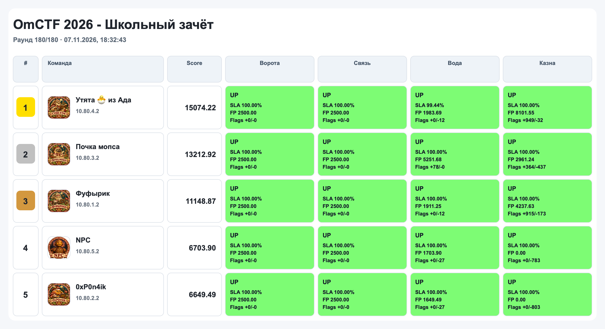
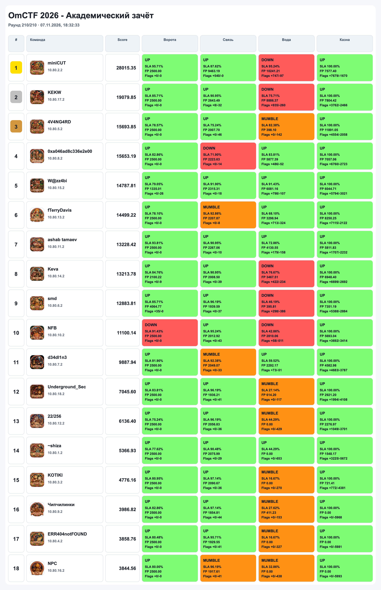

# OmCTF 2026: Attack-Defense

Сервисы, чекеры и сплойты Attack-Defense части OmCTF 2026 (07.11.2026).
Соревнование шло в двух зачётах: школьном и академическом.

## Сервисы

| Сервис | Каталог | Стек | Порт | Чекер | Сплойты |
| --- | --- | --- | --- | --- | --- |
| Ворота | [services/gates](services/gates), исходники в [sources/gates](sources/gates) | Python (BlackSheep, Celery), Rust, PostgreSQL, Redis | TCP 7777 | [checkers/gates](checkers/gates) | [2](sploits/gates) |
| Связь | [services/post](services/post) | Go, Rust, React, PostgreSQL, Redis | TCP 18080 (HTTPS), UDP 20000 | [checkers/post](checkers/post) | [3](sploits/post) |
| Вода | [services/vodokanal](services/vodokanal) | 1С:Предприятие 8.5, Apache, PostgreSQL | TCP 8080 | [checkers/vodokanal](checkers/vodokanal) | [4](sploits/vodokanal) |
| Казна | [arena/treasury](arena/treasury) | C++20 (стратегии команд), Go, Vue | арена | рефери в [arena/treasury](arena/treasury) | — |

Казна не классический AD-сервис, а арена: команды отправляют стратегии
налётчика и обороны на C++, рефери проводит бои между всеми парами команд.
Правила и SDK лежат в [arena/treasury/sdk](arena/treasury/sdk).

Для «Воды» установщик платформы 1С нужно скачать отдельно, подробности в
[README сервиса](services/vodokanal/README.md).

## Структура

```text
services/   сервисы в том виде, в каком их получили команды
sources/    исходники сервисов, выданных в собранном виде
arena/      арена Казны: рефери, SDK, трансляция
checkers/   чекеры ForcAD
board/      визуализация скорборда с демо-данными
sploits/    сплойты и описания уязвимостей
```

## Визуализация

Табло из зала лежит в [board](board): запускается локально на демо-данных.

## Итоги

### Школьный зачёт

1. Утята 🐣 из Ада: 15074.22
2. Почка мопса: 13212.92
3. Фуфырик: 11148.87



### Академический зачёт

1. miniCUT: 28015.35
2. KEKW: 19079.85
3. 4V4NG4RD: 15693.85


